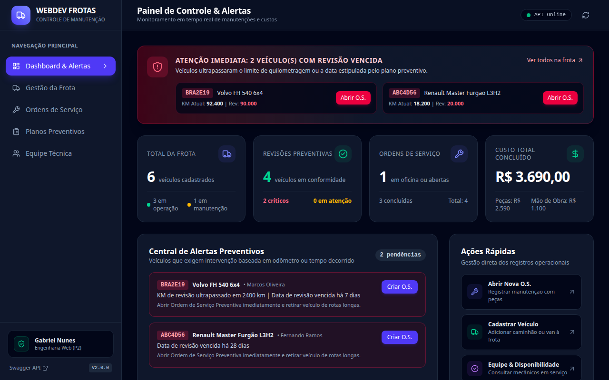
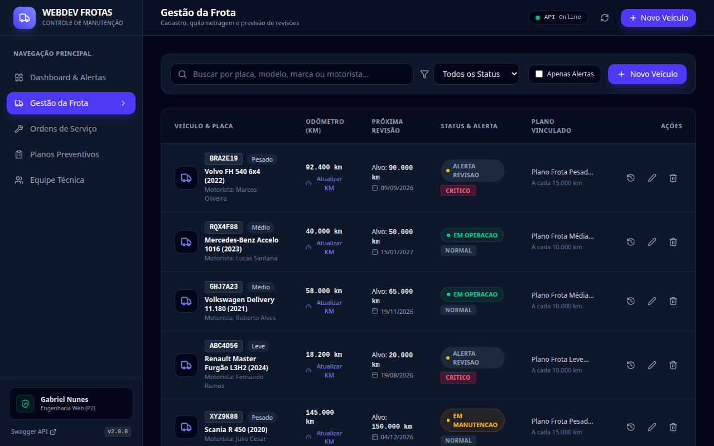
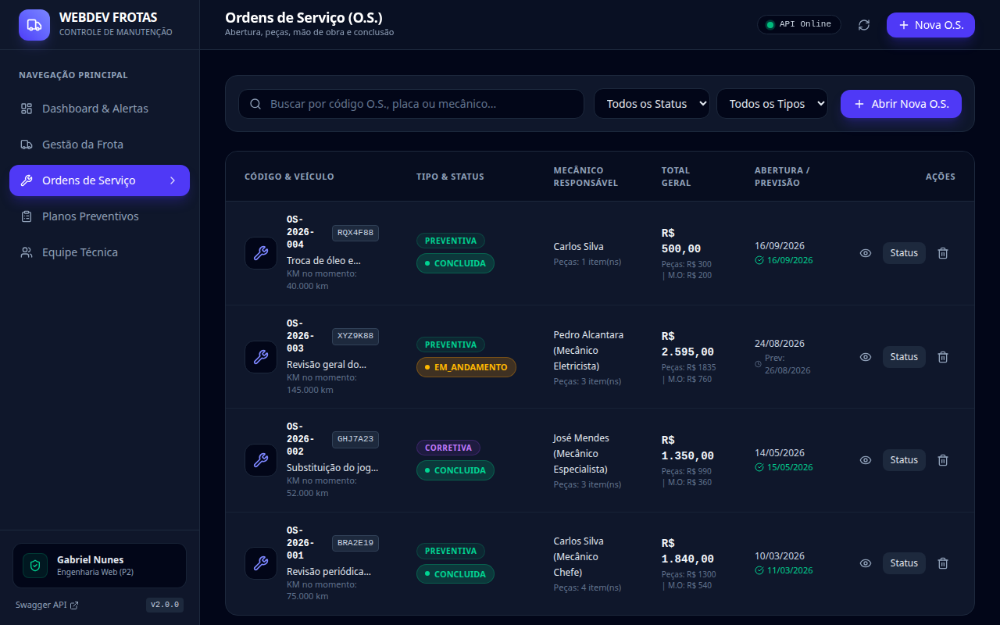
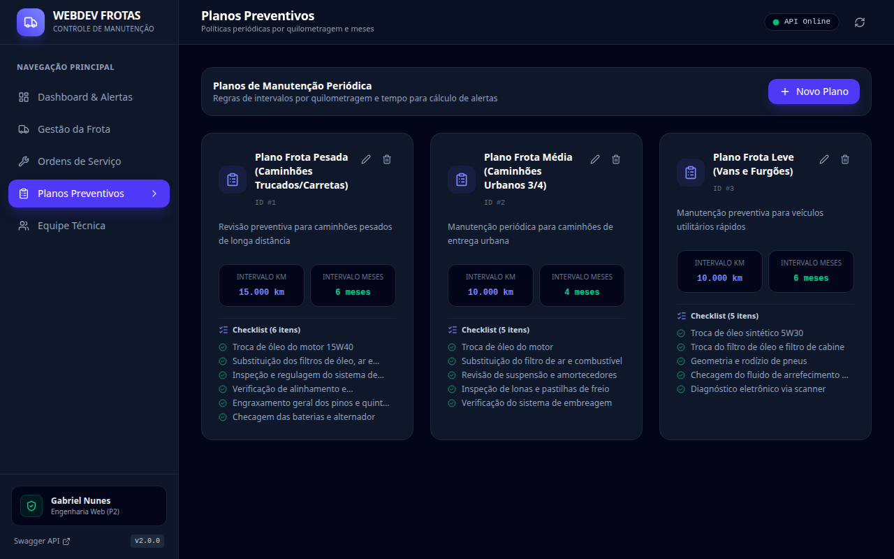
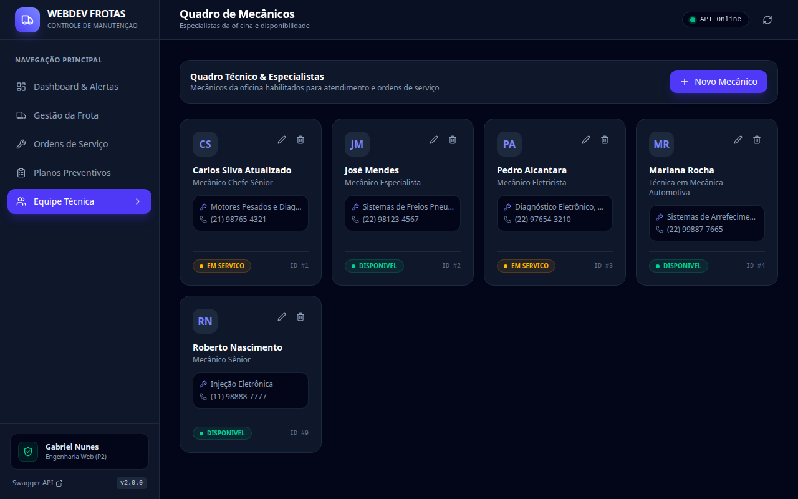
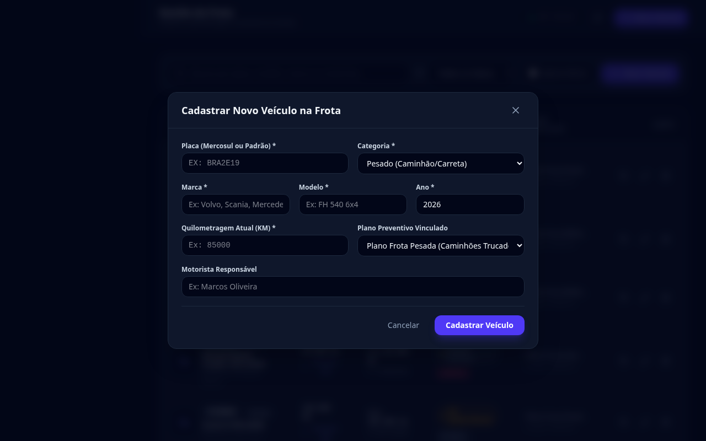
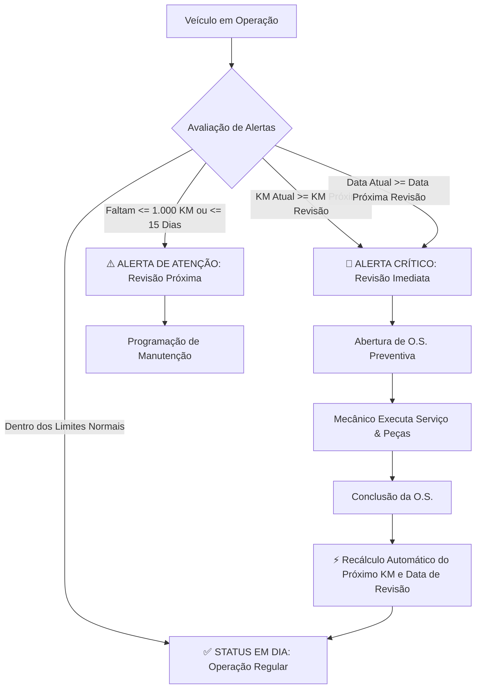

# 🚛 WEBDEV FROTAS — Sistema de Controle de Manutenção de Frotas (Logística)

[](https://nodejs.org/)
[](https://expressjs.com/)
[](https://react.dev/)
[](https://vite.dev/)
[](https://tailwindcss.com/)
[](https://www.prisma.io/)
[](https://www.sqlite.org/)
[](http://localhost:3000/api-docs)
[](#-7-suíte-de-testes-automatizados)
[](#-9-versionamento-semântico-e-release-oficial-v200-p2)
[](LICENSE)

> **Avaliação Parcial (P2) — Disciplina de Desenvolvimento Web**  
> **Aluno / Gestor:** Gabriel Nunes da Silva  
> **Tema:** Controle de Manutenção de Frotas (Logística)  
> **Modelo Front-end Escolhido:** SPA (Single Page Application com React.js, Hooks e Tailwind CSS)

---

## 📌 1. Visão Geral do Sistema

O **WEBDEV FROTAS** é um sistema corporativo de gestão logística e operacional de frotas de transporte (caminhões pesados, cavalos mecânicos, caminhões médios 3/4, utilitários e vans), com foco primordial na **manutenção preventiva sistemática**, no controle detalhado de **Ordens de Serviço (O.S.)** — discriminando itens de peças substituídas e horas de mão de obra técnica —, na gestão do **quadro de mecânicos e especialistas** e na prevenção de falhas através de um **mecanismo proativo de alertas de revisão**.

Na **P2**, o sistema foi complementado com uma **Interface SPA moderna desenvolvida em React.js**, consumindo a API RESTful Node.js / Express com CORS ativo, controle de estado com Hooks (`useState`, `useEffect`), persistência em banco relacional via **Prisma ORM + SQLite** e estilização corporativa com **Tailwind CSS**.

### 👥 Perfis de Usuário e Casos de Uso:
1. **Gestor de Frota (Gabriel Nunes da Silva):**
   - Cadastra, edita e gerencia veículos da frota com odômetro e motoristas atribuídos.
   - Vincula veículos a planos de manutenção preventiva com periodicidade por quilometragem e intervalo de tempo.
   - Monitora o painel de alertas críticos (veículos com revisão vencida por KM ou data).
   - Acompanha custos acumulados em peças e mão de obra através de indicadores consolidados (Dashboard).
   - Gerencia o quadro de mecânicos e suas especialidades técnicas.

2. **Mecânico (Oficina):**
   - Registra e atualiza Ordens de Serviço (O.S.).
   - Adiciona dinamicamente peças aplicadas (especificando quantidade e valor unitário com cálculo dinâmico de subtotal).
   - Registra horas trabalhadas e valor-hora de mão de obra especializada.
   - Conclui manutenções preventivas, acionando o **recálculo automatizado do próximo ciclo de revisão do veículo**.

---

## 💻 2. Guia de Execução Local (Passo a Passo)

O projeto foi estruturado de forma unificada para que o avaliador execute o back-end e o front-end React na mesma porta (`3000`) com comandos simples e padronizados.

### Pré-requisitos:
- **Node.js** (versão 20+ ou 22+)
- **npm** (versão 10+)

### Comandos de Instalação e Execução:

```bash
# 1. Clonar o repositório oficial
git clone https://github.com/Desenvolvimento-Web-2026-1-ENG/Controle-de-Manutencao-de-Frotas.git
cd Controle-de-Manutencao-de-Frotas

# 2. Instalar dependências da raiz e compilar a aplicação React
npm install
npm run build

# 3. Executar as migrações e popular o banco SQLite inicial
npx prisma migrate dev --name init_sqlite
npx prisma db seed

# 4. Iniciar o servidor unificado
npm start
```

### URLs de Acesso no Navegador:
* **Aplicação Front-end SPA (React.js):** [http://localhost:3000](http://localhost:3000)
* **Documentação Interativa Swagger UI:** [http://localhost:3000/api-docs](http://localhost:3000/api-docs)
* **Status da API REST:** [http://localhost:3000/api/status](http://localhost:3000/api/status)

### Modo de Desenvolvimento (Opcional):
Para rodar com hot-reload no back-end e no front-end:
```bash
# Terminal 1: Servidor Express
npm run dev

# Terminal 2: Servidor Vite React
npm run frontend:dev
```

---

## 📸 3. Guia de Telas (Screenshots do Front-end React)

A interface SPA foi projetada com design system corporativo sóbrio, dark-mode, mobile-first e acessibilidade WCAG AA.

### 📊 3.1 Painel de Controle & Central de Alertas (Dashboard)
Painel com indicadores consolidados da frota, status preventivo, métricas de custos em peças e mão de obra, banner de veículos críticos e central de alertas:


---

### 🚛 3.2 Gestão da Frota de Veículos (CRUD Completo)
Tabela responsiva com odômetro, próxima revisão calculada, badges semânticos de nível de alerta (`NORMAL`, `ATENÇÃO`, `CRÍTICO`), filtros por status, busca em tempo real e ações de atualização de KM, histórico, edição e exclusão:


---

### 🔧 3.3 Ordens de Serviço (O.S.)
Controle de manutenções com filtro por status (`ABERTA`, `EM_ANDAMENTO`, `CONCLUIDA`, `CANCELADA`) e tipo (`PREVENTIVA`, `CORRETIVA`), visualização de custos de peças e mão de obra:


---

### 📋 3.4 Planos de Manutenção Preventiva
Configuração de políticas periódicas por quilometragem e intervalo de meses, além do checklist detalhado de checagem técnica:


---

### 👨‍🔧 3.5 Quadro Técnico de Mecânicos & Especialistas
Gestão dos mecânicos da oficina com especialidade técnica, telefone e status operacional (`DISPONIVEL`, `EM_SERVICO`, `AFASTADO`):


---

### 📝 3.6 Modal Reativo de Cadastro e Validações
Formulários modais com validações de campos obrigatórios, detecção de placas duplicadas e tratamento de erros:


---

## ⚙️ 4. Regras de Negócio e Lógica de Alertas

Cada veículo cadastrado possui um **Plano de Manutenção** associado. O sistema avalia dinamicamente dois critérios primordiais:



1. **Alerta Crítico (Revisão Imediata):** Ativado quando a quilometragem atual do veículo atinge ou ultrapassa a `kmProximaRevisao` OU a data atual atinge ou ultrapassa a `dataProximaRevisao`.
2. **Alerta de Atenção:** Ativado quando faltam **menos de 1.000 km** ou **menos de 15 dias** para o vencimento da revisão preventiva.
3. **Fechamento de O.S. com Recálculo Inteligente:** Ao concluir uma Ordem de Serviço do tipo `PREVENTIVA`, a API atualiza o KM do veículo e projeta automaticamente a próxima revisão com base no intervalo definido no plano (`kmProximaRevisao = kmAtual + intervaloKm` e `dataProximaRevisao = hoje + intervaloMeses`).

---

## 🏗️ 5. Arquitetura em Camadas (Front-end & Back-end)

O projeto adota uma arquitetura em camadas modularizada, desacoplada e escalável:

```
controleManutencaoFrotas/
├── frontend/                   # Aplicação Front-end SPA React.js
│   ├── src/
│   │   ├── components/         # Componentes organizados por domínio
│   │   │   ├── common/         # Modais, Toasts e componentes compartilhados
│   │   │   ├── dashboard/      # Métricas consolidadas e alertas
│   │   │   ├── veiculos/       # CRUD de veículos, odômetro e histórico
│   │   │   ├── ordens/         # CRUD de O.S., itens e transição de status
│   │   │   ├── planos/         # Planos preventivos e checklists
│   │   │   ├── mecanicos/      # Gestão da equipe técnica
│   │   │   └── layout/         # Header, Sidebar e navegação por abas
│   │   ├── services/
│   │   │   └── api.js          # Módulo centralizado de consumo da API (Fetch)
│   │   ├── App.jsx             # Shell da SPA com gestão de estado global
│   │   ├── index.css           # Configuração base Tailwind CSS v4
│   │   └── main.jsx            # Ponto de entrada do React
│   ├── vite.config.js          # Configuração Vite com proxy e Tailwind
│   └── package.json            # Dependências do front-end (React, Lucide, Tailwind)
├── prisma/                     # Persistência com Prisma ORM v6
│   ├── schema.prisma           # Modelagem relacional com SQLite (@@map e @map)
│   ├── dev.db                  # Banco de dados relacional SQLite
│   ├── seed.js                 # Seeder automatizado com dados realistas
│   └── migrations/             # Histórico de versionamento SQL das tabelas
├── src/                        # Back-end Node.js / Express
│   ├── app.js                  # Configuração Express, CORS, estáticos e fallback SPA
│   ├── server.js               # Inicialização HTTP
│   ├── config/
│   │   ├── prisma.js           # Singleton do PrismaClient
│   │   └── swagger.js          # Documentação OpenAPI 3.0
│   ├── controllers/            # Controladores assíncronos HTTP
│   ├── middlewares/            # Tratamento centralizado de erros e CORS
│   ├── routes/                 # Roteamento RESTful modularizado
│   └── services/               # Camada de regras de negócio desacoplada
├── tests/
│   └── api.test.js             # Suíte com 20 testes de integração automatizados
├── docs/
│   ├── screenshots/            # Galeria de capturas da interface React
│   └── postman_collection.json # Coleção Postman com asserções automatizadas
└── package.json                # Configurações raiz e scripts unificados
```

---

## 🗄️ 6. Modelo de Banco de Dados Relacional (Prisma & SQLite)

O banco de dados SQLite foi modelado no arquivo `prisma/schema.prisma` seguindo as boas práticas de engenharia de software com mapeamento de nomes via `@map` e `@@map` e integridade referencial:

* **`planos_manutencao` (`PlanoManutencao`):** Armazena intervalos de quilometragem, meses e checklist de itens. Relacionamento `1:N` com veículos.
* **`veiculos` (`Veiculo`):** Registra a frota, odômetro atual, datas e quilometragens das revisões. Chave estrangeira `plano_manutencao_id` (`onDelete: SetNull`). Relacionamento `1:N` com ordens de serviço.
* **`ordens_servico` (`OrdemServico`):** Registro de intervenções preventivas e corretivas, peças em JSON, mão de obra técnica e totais financeiros. Chave estrangeira `veiculo_id` (`onDelete: Restrict`).
* **`mecanicos` (`Mecanico`):** Quadro de profissionais, especialidades técnicas e status de disponibilidade.

---

## 🧪 7. Suíte de Testes Automatizados

O projeto possui **20 testes automatizados de integração**, executados diretamente pelo test runner nativo do Node.js (`node --test`), com reset automático do banco de dados SQLite a cada execução:

```bash
npm test
```

### Saída da Execução (100% de Sucesso):
```text
✔ GET /api/status - Deve retornar status online e nome WEBDEV FROTAS (200 OK)
✔ GET /api/dashboard/resumo - Deve retornar indicadores consolidados (200 OK)
✔ GET /api/dashboard/alertas - Deve identificar alertas críticos e de atenção (200 OK)
✔ GET /api/mecanicos - Deve listar os mecânicos cadastrados (200 OK)
✔ POST /api/mecanicos - Deve cadastrar novo mecânico (201 Created)
✔ PUT /api/mecanicos/:id - Deve editar dados do mecânico (200 OK)
✔ DELETE /api/mecanicos/:id - Deve excluir mecânico (200 OK)
✔ POST /api/mecanicos - Deve rejeitar sem nome (400 Bad Request)
✔ GET /api/mecanicos/:id - Deve retornar 404 para mecânico inexistente
✔ GET /api/veiculos - Deve listar veículos e permitir filtros (200 OK)
✔ POST /api/veiculos - Deve validar campos obrigatórios (400 Bad Request)
✔ POST /api/veiculos - Deve recusar placa duplicada (409 Conflict)
✔ POST /api/veiculos - Deve cadastrar veículo e calcular próxima revisão (201 Created)
✔ GET /api/veiculos/:id - Deve retornar 404 para veículo inexistente
✔ GET /api/veiculos/:id - Deve retornar 400 para ID não numérico
✔ PATCH /api/veiculos/:id/km - Deve recusar KM menor que o atual (400 Bad Request)
✔ DELETE /api/veiculos/:id - Deve recusar exclusão de veículo com OS ativa (400 Bad Request)
✔ POST /api/ordens-servico - Deve recusar OS para veículo inexistente (404 Not Found)
✔ POST /api/ordens-servico e PATCH status - Deve abrir OS e recalcular revisão na conclusão (201 & 200)
✔ PATCH /api/ordens-servico/:id/status - Deve recusar status inválido (400 Bad Request)

ℹ tests 20 | pass 20 | fail 0 (100% de sucesso)
```

---

## 🌐 8. Resumo dos Endpoints da API REST

A documentação interativa e interativa Swagger está disponível em `http://localhost:3000/api-docs`.

| Módulo | Método | Endpoint | Descrição Principal |
| :--- | :---: | :--- | :--- |
| **Status** | `GET` | `/api/status` | Verificação de integridade e metadados da aplicação. |
| **Dashboard** | `GET` | `/api/dashboard/resumo` | Métricas consolidadas da frota, O.S. e financeiro. |
| **Dashboard** | `GET` | `/api/dashboard/alertas` | Relatório de veículos em alerta crítico ou atenção. |
| **Veículos** | `GET` | `/api/veiculos` | Listagem com filtros por marca, modelo, categoria e alertas. |
| **Veículos** | `GET` | `/api/veiculos/:id` | Detalhes do veículo e alerta calculado. |
| **Veículos** | `POST` | `/api/veiculos` | Cadastro de novo veículo com validação de placa. |
| **Veículos** | `PUT` | `/api/veiculos/:id` | Atualização cadastral do veículo. |
| **Veículos** | `PATCH` | `/api/veiculos/:id/km` | Atualização do odômetro (valida avanço de KM). |
| **Veículos** | `DELETE` | `/api/veiculos/:id` | Exclusão de veículo (bloqueia se houver O.S. ativa). |
| **Veículos** | `GET` | `/api/veiculos/:id/historico` | Histórico completo de manutenções do veículo. |
| **Ordens de Serviço** | `GET` | `/api/ordens-servico` | Listagem de O.S. com filtros de status e tipo. |
| **Ordens de Serviço** | `POST` | `/api/ordens-servico` | Emissão de O.S. com peças, mão de obra e totais. |
| **Ordens de Serviço** | `PATCH` | `/api/ordens-servico/:id/status` | Transição de status (recalcula revisão na conclusão). |
| **Ordens de Serviço** | `DELETE` | `/api/ordens-servico/:id` | Cancelamento/exclusão de O.S. |
| **Planos** | `GET` | `/api/planos-manutencao` | Listagem de planos preventivos. |
| **Planos** | `POST` | `/api/planos-manutencao` | Criação de novo plano preventivo. |
| **Mecânicos** | `GET` | `/api/mecanicos` | Listagem de mecânicos e disponibilidade. |
| **Mecânicos** | `POST` | `/api/mecanicos` | Cadastro de novo mecânico na equipe. |

---

## 🏷️ 9. Versionamento Semântico e Release Oficial (`v2.0.0-p2`)

O projeto segue as diretrizes do versionamento semântico ([SemVer](https://semver.org/)):

* **Release P2 (Atual):** [`v2.0.0-p2`](https://github.com/Desenvolvimento-Web-2026-1-ENG/Controle-de-Manutencao-de-Frotas/releases/tag/v2.0.0-p2)
  - **Título Oficial:** `Entrega P2 - Interface React`
  - **Descrição:** Front-end SPA integrado com React.js, Tailwind CSS, Prisma ORM e SQLite, com link para o vídeo de apresentação.
* **Release P1 (Congelada):** [`v1.0.0-p1`](https://github.com/Desenvolvimento-Web-2026-1-ENG/Controle-de-Manutencao-de-Frotas/releases/tag/v1.0.0-p1)
  - Congelamento da arquitetura da API REST, Swagger e testes da primeira etapa.

---

## ✅ 10. Checklist de Requisitos da Avaliação P2

- [x] **Modelo SPA implementado:** Front-end desenvolvido em **React.js** com componentes funcionais.
- [x] **Consumo de API:** Requisições via `fetch` tratando respostas de sucesso (`200`, `201`) e erros (`400`, `404`, `409`).
- [x] **Gestão de Estado com Hooks:** Uso extensivo de `useState` para controle de formulários, modais e filtros, e `useEffect` para ciclo de vida.
- [x] **CORS:** Middleware `cors` configurado e ativo no Express.
- [x] **CRUDs Funcionais:** Telas completas com listagem, criação, edição e exclusão de Veículos, O.S., Planos e Mecânicos.
- [x] **Navegação (UX):** Sidebar e Header com navegação fluida por abas e hash routing, sem necessidade de digitação de URL.
- [x] **Estilização com Framework CSS:** Interface construída com **Tailwind CSS**, design executivo e ícones `lucide-react`.
- [x] **Persistência Relacional:** Migração e integração com **Prisma ORM v6** e **SQLite**.
- [x] **Documentação Completa (README.md):** Guia de execução local, galeria com screenshots e link da release.
- [x] **Suíte de Testes:** 20/20 testes automatizados passando 100%.

---

### 👨‍💻 Autor
Desenvolvido por **Gabriel Nunes da Silva**  
Disciplina de Desenvolvimento Web (2026-1) — Curso de Engenharia  
Repositório: [https://github.com/Desenvolvimento-Web-2026-1-ENG/Controle-de-Manutencao-de-Frotas](https://github.com/Desenvolvimento-Web-2026-1-ENG/Controle-de-Manutencao-de-Frotas)
